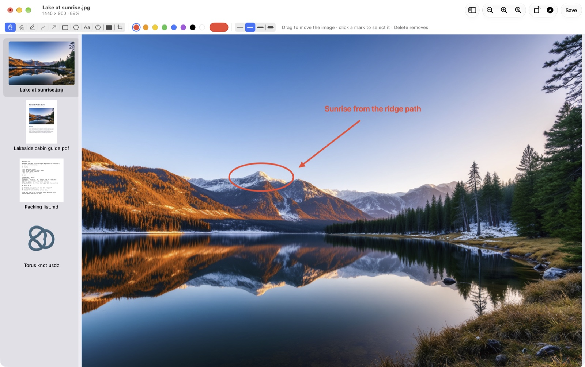
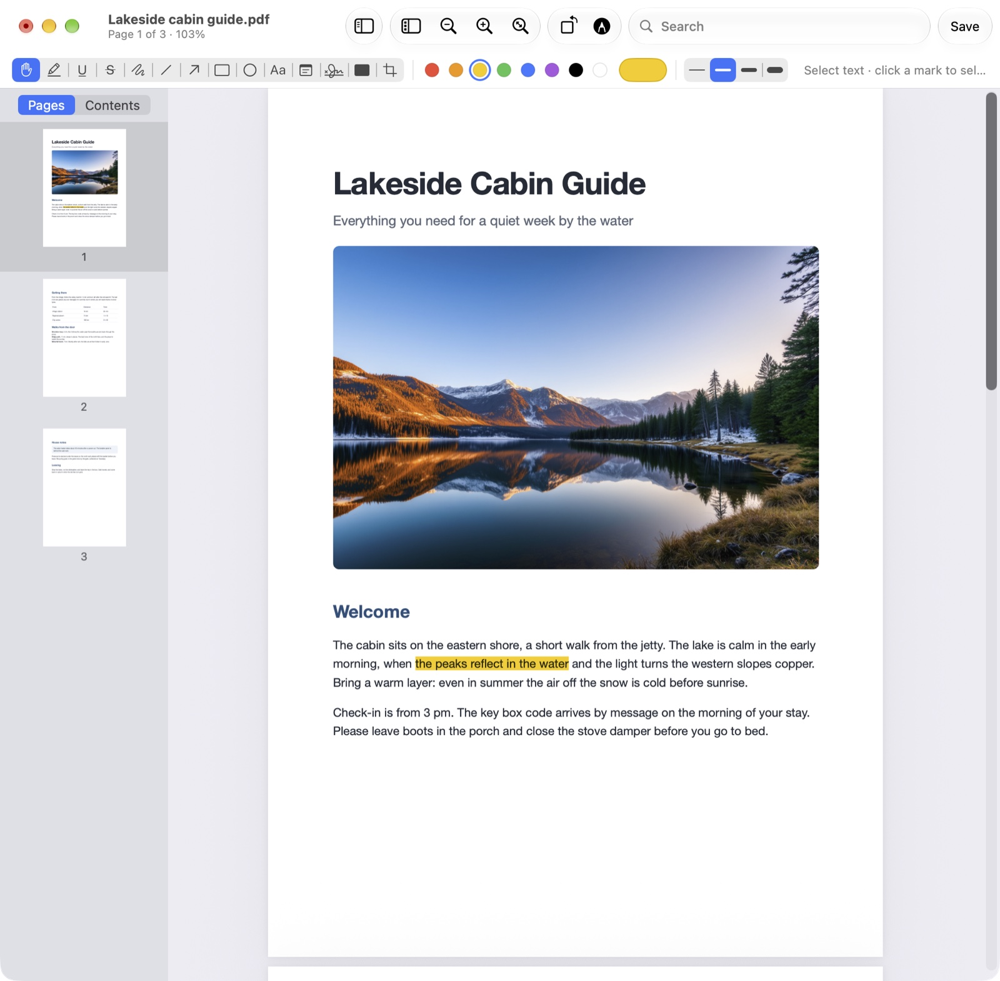
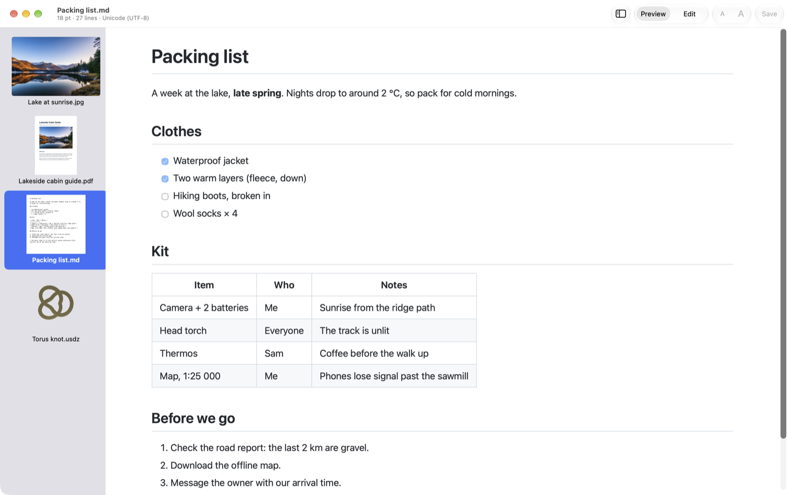
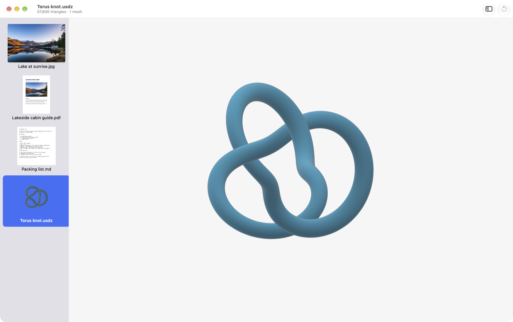

# Focal

**One fast, native Mac viewer for pictures, PDFs, 3D models, movies and text, and it opens windows where you're
looking.**

Preview opens every window at the far left of the screen. On a big or ultrawide display that means turning your
head for every file. Focal opens each window centered on your main display (or the display with the pointer, or
exactly where you last left one), and it shows nearly everything Preview and QuickTime Player do, plus Markdown, RTF and plain text, in one app.



## Why use it

- **Windows stay where you want them.** Centered on the main display, on the display with the pointer, or where you
  last put one. Never cascading down from the top-left corner.
- **Browse without reopening.** ⌘[ and ⌘] (or ← →) step through every file in the folder, whatever its type: a
  photo, then a PDF, then a 3D model, then a movie, in the same window.
- **Open many files as one.** Select files in Finder and open them, or drop a folder on Focal: one window, with a
  thumbnail sidebar. The window keeps its size as you flick through, like a lightbox.
- **Fast.** About 360 ms from a cold launch to a window, about 55 ms per file once it's running. Images are
  sized from their headers and decoded off the main thread.
- **Native.** Swift and AppKit, no Electron, no web views except for rendered Markdown, nothing running in the background.

## What it opens

| Kind | What you can do |
|---|---|
| **Pictures**: JPEG, PNG, HEIC, AVIF, WebP, JPEG XL, TIFF, GIF, BMP, PSD, camera RAW, EXR, SVG… | Scroll to zoom at the pointer, drag to pan, no scroll bars. Markup: pen, highlighter, shapes, arrows, text, numbers, redaction, crop, rotate. Save in place (⌘S or the toolbar button) as PNG, JPEG, HEIC, TIFF, BMP, GIF, TGA, SGI, icons and JPEG 2000; export to OpenEXR and PDF. Animated GIFs play. Multi-page TIFFs and icons show every page, and each page can be edited. |
| **PDFs** | Page thumbnails (drag to reorder, delete, drop in other PDFs or pictures), table of contents, search with every match highlighted. Highlight, underline and strike through text; pen, shapes, text boxes, notes; sign with your trackpad. Fill in forms, rotate and crop pages, print. Password-protected PDFs stay protected when saved. Redaction really removes the text under the box. |
| **3D models**: USD/USDZ, glTF/GLB, OBJ, STL, PLY, Alembic, MaterialX | Drag to orbit, scroll or pinch to zoom, reset the view, copy a snapshot. Animations play. |
| **Movies**: anything AVFoundation plays | Hardware decoding and HDR, trim without re-encoding (⌘T), loop, copy a frame. |
| **Text**: plain text, Markdown, RTF/RTFD | Big, zoomable text with one remembered size. Markdown opens rendered (tables, task lists, footnotes) with an Edit mode. RTF edits with the formatting bar. Encodings and line endings are kept when you save. |

<table>
<tr>
<td width="33%"></td>
<td width="33%"></td>
<td width="33%"></td>
</tr>
<tr>
<td align="center">PDF: page thumbnails, highlighting</td>
<td align="center">Markdown, rendered</td>
<td align="center">3D model (USDZ)</td>
</tr>
</table>

## Install

Download the latest `Focal-x.y.dmg` from [Releases](../../releases), open it and drag Focal to Applications. It's
signed and notarized by Apple. Focal needs **macOS 27 or later on Apple silicon**: that's what it's tested on.

To make Focal the default for a file type: select a file in Finder, **Get Info ▸ Open with: Focal ▸ Change All**.
Settings has buttons for text, Markdown and RTF.

## Keys

| | |
|---|---|
| ⌘[ ⌘] or ← → | Previous / next file in the folder |
| ⌥⌘S | Show the folder (or the files opened together) in a sidebar |
| ⌥⌘2 | Page thumbnails (PDFs, multi-page images) |
| ⌥⌘↑ ⌥⌘↓, ⌥⌘G | Previous / next page, go to page |
| ⇧⌘A | Markup tools |
| ⌘S | Save (no dialog for formats Focal edits in place) |
| ⌘0 ⌘9 ⌘+ ⌘− | Actual size, fit, zoom in, zoom out |
| ⇧⌘P | Markdown: rendered or source |
| ⌘T | Trim a movie |
| ⌘I | Inspector (size, camera, page size, triangle count…) |

## Build from source

Needs Xcode with Swift 6 on macOS 27.

```bash
swift build && swift test             # compile and run the unit tests
scripts/install.sh                    # release build into ~/Applications/Focal.app
scripts/release.sh                    # signed, notarized Apple silicon DMG (needs a Developer ID certificate)
```

`CLAUDE.md` describes the code layout, the UI test harness (`scripts/uitest.sh`) and the decisions behind the
less obvious code.

## Not yet

- MKV and WebM movies (AVFoundation doesn't play them).
- OpenVDB volumes, MacPaint, FlashPix and fax images.

## Licence

Free to use, change and share, including at work, but **not to sell**: MIT with the
[Commons Clause](https://commonsclause.com). See [LICENSE](LICENSE).
